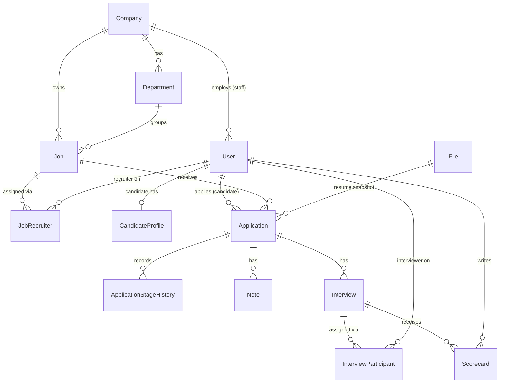

# Data Model

## Master Data vs. Transactional Data

A useful split for most business apps:

- **Master data** — relatively stable reference/core entities that other things point to.
  Changes rarely, usually via an admin flow. Examples: users, products, categories, accounts,
  price lists, org units.
- **Transactional data** — records of things that happened, usually time-stamped and
  append-heavy, referencing master data by ID. Examples: orders, payments, bookings, audit logs,
  sessions.

Why it matters for AI-assisted builds: master data usually needs full CRUD + validation +
admin UI; transactional data usually needs create + read + (rarely) reversal/correction, but
almost never update-in-place or delete — get this distinction into the spec and Claude won't
generate an "edit order" screen you didn't want, or skip audit trails on data that needed one.

In this app: `Company`, `User`, `CandidateProfile`, `Department`, `Job`, `JobRecruiter` are
master data. `Application`, `ApplicationStageHistory`, `Interview`, `Scorecard`, `Note`,
`AuditLog` are transactional (an `Application` is the exception: its stage and version change in
place, with every change also recorded in history). Technical records (`Session`, `Invitation`,
`UserToken`, `BackgroundJob`, `File`, `OAuthIdentity`, `GoogleCalendarConnection`) support the
above.

## Conventions for every entity

- Primary keys are UUIDs on every table (not guessable or countable by outsiders).
- Timestamps are `timestamptz`, stored in UTC (see `CLAUDE.md` > Code Style).
- **Tenant scoping:** every company-scoped table carries a `company_id`, and every query against
  it is filtered by the caller's company (see `security.md` > Authorization). Rows that point at
  each other must belong to the same company; this is enforced in service code and covered by the
  tenant-isolation test.
- Statuses and stages are stored as constrained enums (a Postgres enum or a check constraint),
  never free strings.

## Entities

### Company — Master

- **Purpose:** A tenant. Owns users, departments, jobs and everything below them.
- **Key fields:** `id`, `name`, `created_at`.
- **Relationships:** has many `User` (staff), `Department`, `Job`.
- **Lifecycle:** Created by self-service signup together with its first admin. Name editable by
  an admin. Never deleted in v1 (no suspension or deletion flow).
- **Delete/cascade semantics:** Not deletable in v1.
- **Constraints / invariants:** At least one active company admin at all times.

### User — Master

- **Purpose:** One login account for every person: staff and candidates share one table.
- **Key fields:** `id`, `company_id` (null for candidates), `role` (`company_admin` | `recruiter` |
  `interviewer` | `candidate`), `email`, `full_name`, `password_hash` (null if Google-only),
  `email_verified_at`, `is_active`, `deactivated_at`, `last_login_at`, `created_at`,
  `anonymized_at`.
- **Relationships:** belongs to `Company` (many-to-one, staff only); one-to-one with
  `CandidateProfile` (candidates only); has many `Session`, `OAuthIdentity`.
- **Lifecycle:** Staff are created by accepting an `Invitation`; candidates by self-registration
  or Google sign-in. Role changes by a company admin. Staff are deactivated, never deleted.
  Candidates are anonymized on account deletion (name, email and phone replaced; `anonymized_at`
  set).
- **Delete/cascade semantics:** No hard deletes. Deactivating a user keeps every row that points
  at them (jobs, interviews, scorecards, audit entries) and flags pending work for reassignment.
  Anonymizing a candidate keeps their `Application` rows.
- **Constraints / invariants:** Email unique (case-insensitive) across the whole table, so one
  email is one account. `company_id` is not null for staff roles and null for `candidate`.
  `company_admin` count per company never reaches zero among active users.
- **Status change timestamps:** `deactivated_at`, `anonymized_at`, `email_verified_at`.

### CandidateProfile — Master

- **Purpose:** Candidate-specific details, kept off `User` so staff rows stay clean.
- **Key fields:** `user_id` (PK, FK), `phone`, `location`, `current_resume_file_id`,
  `is_discoverable` (talent pool opt-in, default false), `discoverable_since`. Other profile
  fields (headline, links, work history): [TODO].
- **Relationships:** one-to-one with `User`; references `File`.
- **Lifecycle:** Created at registration. Editable by the candidate only. Personal fields erased
  on anonymization.
- **Delete/cascade semantics:** Follows the `User`. Replacing the resume creates a new `File`;
  the old one stays while any `Application` still references it.
- **Constraints / invariants:** `is_discoverable` can only be true for a non-anonymized,
  verified candidate.

### Department — Master

- **Purpose:** Groups a company's jobs.
- **Key fields:** `id`, `company_id`, `name`, `is_archived`.
- **Relationships:** belongs to `Company`; has many `Job`.
- **Lifecycle:** Created and edited by a company admin. Archived rather than deleted once used.
- **Delete/cascade semantics:** Block deletion while jobs reference it; archive instead.
  Archived departments cannot be picked for new jobs.
- **Constraints / invariants:** `name` unique per company.

### Job — Master

- **Purpose:** An open position that candidates can apply to.
- **Key fields:** `id`, `company_id`, `department_id`, `title`, `location`, `description`,
  `status` (`draft` | `open` | `closed`), `created_by`, `created_at`, `opened_at`, `closed_at`,
  `search_vector` (generated `tsvector` over title + description), `version`.
- **Relationships:** belongs to `Company`, `Department`; has many `JobRecruiter`, `Application`.
- **Lifecycle:** Created by a recruiter (who is auto-assigned) in draft, then published (open),
  then closed. Editable while draft or open. A draft with no applications may be deleted; any
  other job is closed instead.
- **Delete/cascade semantics:** Closing leaves in-flight applications untouched; only new
  applications are refused. A job with applications is never hard-deleted.
- **Constraints / invariants:** `department_id` must belong to the same company. Only `open`
  jobs appear in candidate search and accept applications.
- **Status change timestamps:** `opened_at`, `closed_at`.

### JobRecruiter — Master (assignment)

- **Purpose:** The assignment table behind "a recruiter sees only the jobs assigned to them".
- **Key fields:** `job_id`, `user_id`, `added_by`, `added_at`. Primary key (`job_id`, `user_id`).
- **Relationships:** many-to-many between `Job` and `User` (role recruiter).
- **Lifecycle:** The creating recruiter is added automatically. A company admin or an
  already-assigned recruiter can add others. Removal allowed unless it would leave an open job
  with no recruiter [TODO confirm].
- **Delete/cascade semantics:** Rows are removed with an explicit unassign. A deactivated
  recruiter's rows remain and are flagged for reassignment.
- **Constraints / invariants:** User must be an active recruiter in the job's company.

### Application — Transactional

- **Purpose:** One candidate's application to one job, and where it stands.
- **Key fields:** `id`, `job_id`, `company_id` (copied from the job, to make tenant filtering a
  single-table check), `candidate_id` (`User`), `resume_file_id` (snapshot taken at apply time),
  `stage` (`applied` | `screening` | `interview` | `offer` | `hired` | `rejected` | `withdrawn`),
  `rejected_from_stage`, `stage_before_withdrawal` (so reactivation can restore it),
  `rejection_reason` (`skills_mismatch` | `position_filled` | `candidate_unresponsive` |
  `failed_interview` | `other`), `rejection_comment` (internal only), `version`, `created_at`, `updated_at`.
- **Relationships:** belongs to `Job` and candidate `User`; has many `ApplicationStageHistory`,
  `Note`, `Interview`.
- **Lifecycle:** Created by the candidate. Stage changed by recruiters (forward, or reject), and
  by the candidate (withdraw/reactivate). Never edited otherwise, never deleted.
- **Delete/cascade semantics:** Never deleted. If the candidate is anonymized, the row stays and
  the candidate shows as "Deleted candidate".
- **Constraints / invariants:** Unique (`candidate_id`, `job_id`). `company_id` equals the job's
  `company_id`. `rejection_reason` is required when `stage = rejected`. Updates must supply the
  expected `version` (optimistic locking). `rejection_comment` is required when
  `rejection_reason = other`.
- **Status change timestamps:** every stage change is its own `ApplicationStageHistory` row.
- Allowed transitions: forward one stage at a time, or to `rejected` from any stage; `withdrawn`
  by the candidate from any non-terminal stage; reactivation returns to
  `stage_before_withdrawal`. No skipping, no moving backwards (see `functional.md`).

### ApplicationStageHistory — Transactional

- **Purpose:** One row per stage change, for the funnel, time-in-stage and "since when" questions.
- **Key fields:** `id`, `application_id`, `from_stage` (null for the first row), `to_stage`,
  `changed_by`, `changed_at`.
- **Relationships:** belongs to `Application`.
- **Lifecycle:** Append-only.
- **Delete/cascade semantics:** Never deleted.
- **Constraints / invariants:** Written in the same transaction as the stage change.

### Interview — Transactional

- **Purpose:** One interview round for an application.
- **Key fields:** `id`, `company_id`, `application_id`, `round_name`, `scheduled_at` (UTC),
  `duration_minutes`, `location` (free text), `status` (`scheduled` | `completed` | `cancelled`),
  `scheduled_by`, `google_event_id` (nullable), `calendar_sync_status`
  (`not_requested` | `pending` | `synced` | `failed`), `created_at`.
- **Relationships:** belongs to `Application`; has many `InterviewParticipant`, `Scorecard`.
- **Lifecycle:** Created by a recruiter. Rescheduling and cancelling: [TODO].
- **Delete/cascade semantics:** Never deleted; cancelled instead.
- **Constraints / invariants:** Interviewers must be active staff of the same company.

### InterviewParticipant — Transactional (assignment)

- **Purpose:** Assigns interviewers to an interview; the basis of "sees only their interviews".
- **Key fields:** `interview_id`, `interviewer_id`, `assigned_at`. Primary key
  (`interview_id`, `interviewer_id`).
- **Relationships:** many-to-many between `Interview` and `User` (role interviewer).
- **Lifecycle:** Created when scheduling; changes while no scorecard has been submitted by that
  interviewer [TODO confirm].
- **Delete/cascade semantics:** Not removable once that interviewer has submitted a scorecard.
- **Constraints / invariants:** Interviewer must belong to the interview's company.

### Scorecard — Transactional

- **Purpose:** One interviewer's evaluation of one interview.
- **Key fields:** `id`, `interview_id`, `interviewer_id`, `overall_rating` (1-5),
  `technical_rating`, `communication_rating`, `problem_solving_rating`, `culture_fit_rating`
  (each 1-5, the fixed criteria set), `feedback`, `recommendation` (`strong_no` | `no` | `yes` |
  `strong_yes`), `submitted_at`.
- **Relationships:** belongs to `Interview` and `User`.
- **Lifecycle:** Created once by the interviewer, on submit. Final: no editing after submission.
- **Delete/cascade semantics:** Never deleted.
- **Constraints / invariants:** Unique (`interview_id`, `interviewer_id`). The author must have
  an `InterviewParticipant` row. Visibility rule (blind scoring) is enforced by the API query,
  not stored as a flag.

### Note — Transactional

- **Purpose:** Internal comments on an application, visible to company staff with access to it.
- **Key fields:** `id`, `application_id`, `company_id`, `author_id`, `body`, `created_at`.
- **Relationships:** belongs to `Application`, `User`.
- **Lifecycle:** Append-only; no edit or delete in v1.
- **Delete/cascade semantics:** Never deleted. Never shown to candidates or to interviewers.
- **Constraints / invariants:** Author is a recruiter or admin with access to the application.

### AuditLog — Transactional

- **Purpose:** Answers "who changed what, when" for hiring decisions.
- **Key fields:** `id`, `company_id` (null for candidate-only actions), `actor_user_id`,
  `action`, `entity_type`, `entity_id`, `old_value` (JSON), `new_value` (JSON), `created_at`.
- **Relationships:** points at other entities by type and id; no foreign key, so history
  survives anything.
- **Lifecycle:** Append-only, written in the same transaction as the change it describes.
- **Delete/cascade semantics:** Never deleted. On anonymization, `actor_user_id` still points at
  the anonymized user row.
- **Constraints / invariants:** `old_value`/`new_value` never contain passwords, tokens, or
  resume contents.

### File — Technical

- **Purpose:** Metadata for an uploaded resume stored in object storage.
- **Key fields:** `id`, `owner_user_id`, `storage_key` (generated by the app), `original_filename`
  (display only), `content_type`, `size_bytes`, `uploaded_at`, `deleted_at`.
- **Relationships:** referenced by `CandidateProfile` and `Application`.
- **Lifecycle:** Immutable once uploaded. A "replacement" is a new `File`.
- **Delete/cascade semantics:** Removed from storage only when the owner is anonymized.
- **Constraints / invariants:** Only the key is stored, resolved against the configured bucket;
  see `security.md` > File Upload Handling.

### Session — Technical

- **Purpose:** Server-side login session behind the httpOnly cookie, so idle timeout and
  revocation (deactivation, password change, account deletion) work.
- **Key fields:** `id` (hash of the cookie token), `user_id`, `created_at`, `last_seen_at`,
  `expires_at`, `revoked_at`.
- **Relationships:** belongs to `User`.
- **Lifecycle:** Created at login; `last_seen_at` slides the idle timeout; expired rows are
  purged by a scheduled job [TODO].
- **Delete/cascade semantics:** Revoked, not deleted, when the user is deactivated or anonymized.
- **Constraints / invariants:** Idle timeout is 30 minutes for staff and 7 days for candidates.

### Invitation, UserToken, OAuthIdentity, GoogleCalendarConnection — Technical

- **Invitation:** `id`, `company_id`, `email`, `role`, `token_hash`, `invited_by`, `expires_at`
  (7 days), `accepted_at`. Single-use; the token is stored hashed.
- **UserToken:** `id`, `user_id`, `type` (`email_verification` | `password_reset`), `token_hash`,
  `expires_at` (24 hours / 1 hour), `used_at`. Single-use; hashed.
- **OAuthIdentity:** `id`, `user_id`, `provider` (`google`), `provider_subject`, `linked_at`.
  Unique (`provider`, `provider_subject`).
- **GoogleCalendarConnection:** `user_id`, `refresh_token_encrypted`, `scopes`, `connected_at`.
  The refresh token is encrypted at rest (see `security.md` > Data Protection). Removing the
  connection deletes the row.

### BackgroundJob — Technical

- **Purpose:** The Postgres-backed queue behind emails and calendar events. Also the
  "transactional outbox": jobs are inserted in the same transaction as the change that triggers
  them, so a committed stage change always has its email queued.
- **Key fields:** `id`, `type`, `payload` (JSON, no secrets), `status` (`pending` | `running` |
  `succeeded` | `failed`), `attempts`, `max_attempts` (5), `run_at`, `locked_at`, `last_error`,
  `idempotency_key`, `created_at`, `finished_at`.
- **Lifecycle:** Claimed by the worker with `SELECT ... FOR UPDATE SKIP LOCKED`. Retry policy and
  failure handling are in `operations.md` > Background Jobs & Queues.
- **Constraints / invariants:** `idempotency_key` unique, so a retried or double-enqueued action
  produces one email.

---

## Change Auditing

- Which entities need a full change history? `Application` (stage changes, rejection, withdrawal),
  `Scorecard` (submission), `Note` (creation), `Job` (status changes), `Interview` (create,
  reschedule, cancel), `User` (role change, deactivation), `JobRecruiter` and
  `InterviewParticipant` (assignment changes), and talent pool profile views [TODO whether in
  scope].
- Dedicated audit-log entity (`AuditLog`, above), because hiring decisions are legally sensitive
  and the log must be queryable independent of the record it describes. `ApplicationStageHistory`
  additionally exists for the analytics queries; it is not a substitute for the audit log.

## Bulk Operations

> **Skip unless** this app imports records from a file or feed, or updates many records in one
> action. These questions have no cheap answer later — the mechanisms below are schema, not code.

(Skipped: v1 has no file import or feed and no bulk update. Anonymizing a candidate touches many
rows but is one user's action inside one transaction.)

## Relationships Overview

## Data Retention / Archival

- Candidate anonymization on request (see `User`). Retention period for rejected applications
  and for audit data, and any automatic purge: [TODO]
- Session and token rows are purged after expiry; schedule and window: [TODO]
- Succeeded `BackgroundJob` rows older than a retention window are purged: [TODO]
